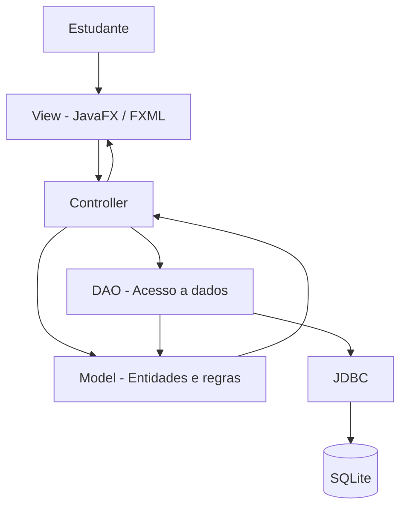
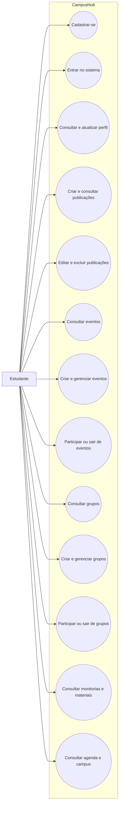
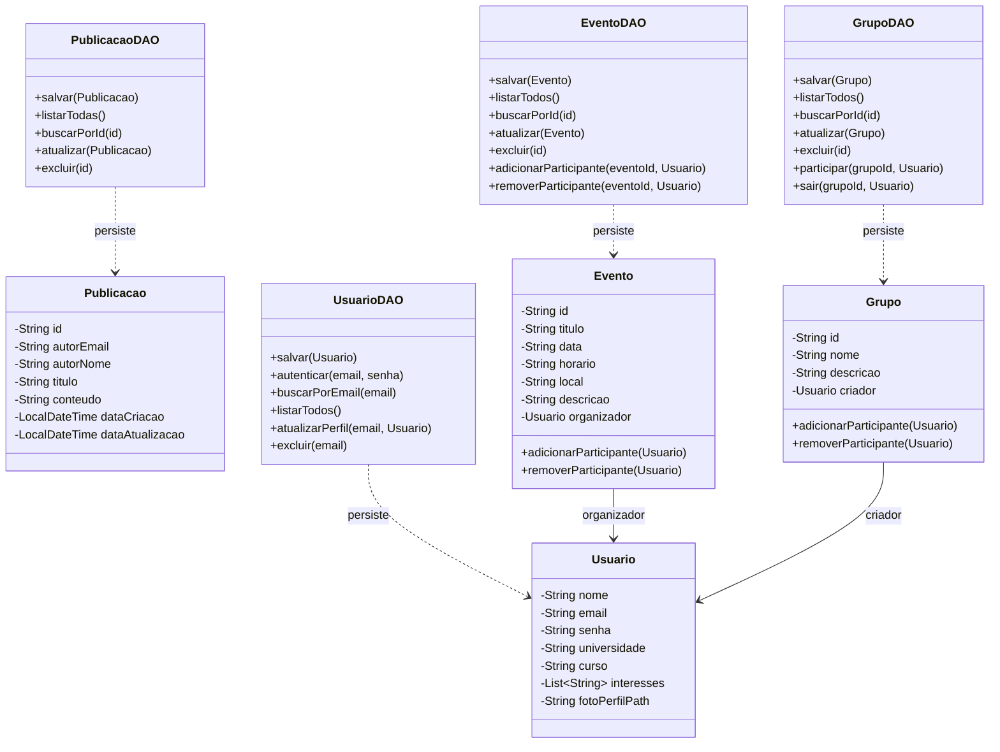
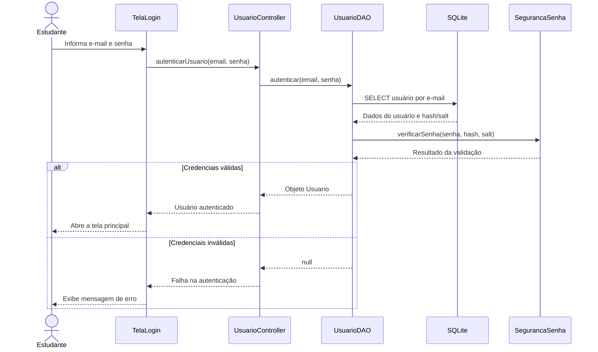
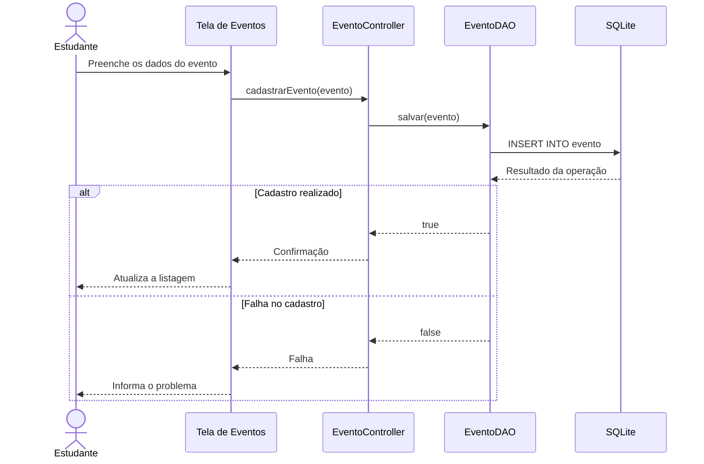
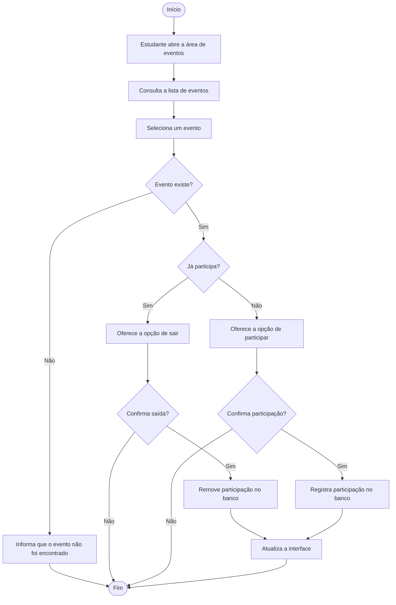
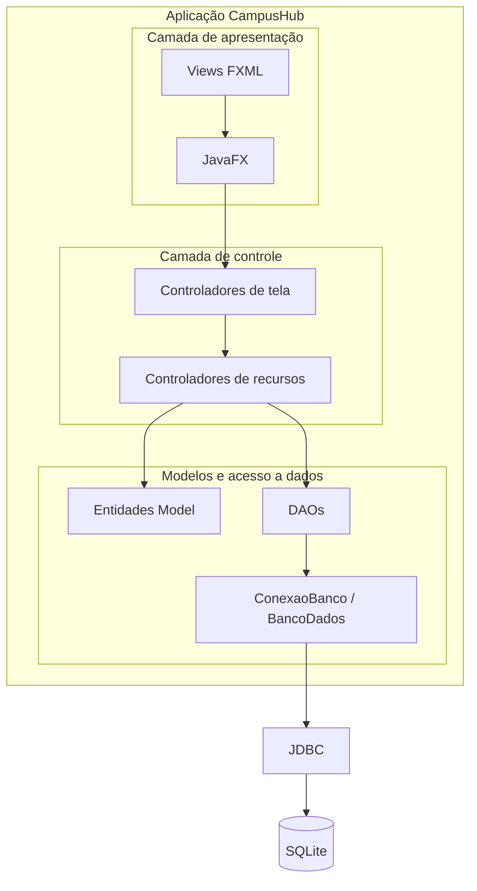
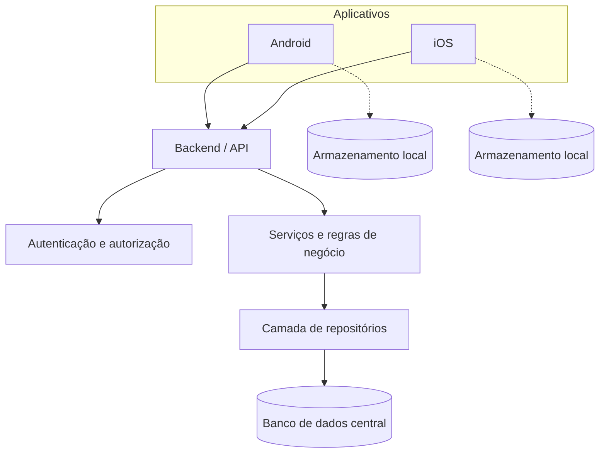

<div align="center">

# CampusHub

### Conectando estudantes, informações, oportunidades e experiências em um único ambiente universitário.

**Protótipo acadêmico de um ecossistema digital universitário desenvolvido em Java e JavaFX.**

</div>

---

## Sumário

- [1. Apresentação](#1-apresentação)
- [2. Objetivos e público-alvo](#2-objetivos-e-público-alvo)
- [3. Como o CampusHub funciona](#3-como-o-campushub-funciona)
- [4. Módulos e estado de implementação](#4-módulos-e-estado-de-implementação)
- [5. Tecnologias utilizadas](#5-tecnologias-utilizadas)
- [6. Organização e arquitetura](#6-organização-e-arquitetura)
- [7. Operações CRUD](#7-operações-crud)
- [8. Banco de dados e persistência](#8-banco-de-dados-e-persistência)
- [9. Diagramas do sistema](#9-diagramas-do-sistema)
- [10. Organização da equipe](#10-organização-da-equipe)
- [11. Interface desktop com experiência mobile](#11-interface-desktop-com-experiência-mobile)
- [12. Possível adaptação para Android e iOS](#12-possível-adaptação-para-android-e-ios)
- [13. Estrutura do projeto](#13-estrutura-do-projeto)
- [14. Como executar](#14-como-executar)
- [15. Limitações e trabalhos futuros](#15-limitações-e-trabalhos-futuros)
- [16. Considerações finais](#16-considerações-finais)

---

## 1. Apresentação

O **CampusHub** é um projeto acadêmico que propõe a criação de um ecossistema digital capaz de reunir, em um único ambiente, diferentes ferramentas, informações e espaços de interação relacionados à vida universitária.

A proposta parte de um problema comum na rotina dos estudantes: informações acadêmicas, eventos, oportunidades, materiais de estudo, grupos e comunicados costumam estar distribuídos entre diversos aplicativos, sites e canais de comunicação. O CampusHub busca reduzir essa fragmentação ao oferecer um ponto central de acesso a essas experiências.

O público-alvo principal são os **estudantes universitários**. A plataforma foi concebida para apoiar tanto a dimensão acadêmica quanto a dimensão social e comunitária da vida no campus.

O CampusHub não pretende ser apenas uma agenda ou uma rede social universitária. Seu diferencial conceitual está na integração de módulos que atendem a necessidades distintas, mas relacionadas, da comunidade acadêmica.

> **Importante:** este repositório contém um protótipo acadêmico funcional desenvolvido para desktop com JavaFX. A interface simula a experiência visual de um aplicativo mobile, mas o projeto ainda não é um aplicativo nativo para Android ou iOS.

## 2. Objetivos e público-alvo

### Objetivo geral

Desenvolver um protótipo de plataforma universitária integrada, aplicando conceitos de programação orientada a objetos, interfaces gráficas, persistência de dados, arquitetura de software, modelagem e trabalho colaborativo.

### Objetivos específicos

- Centralizar informações e recursos relacionados à experiência universitária.
- Facilitar a descoberta e a participação em eventos.
- Permitir a criação e a participação em grupos de estudantes.
- Oferecer um espaço para publicações e compartilhamento de informações.
- Reunir recursos acadêmicos, como monitorias, materiais e agenda.
- Apresentar informações sobre espaços e atividades do campus.
- Aplicar operações CRUD em entidades do sistema.
- Organizar o código com separação de responsabilidades inspirada em MVC.
- Construir uma base que possa orientar uma futura versão mobile.

### Público-alvo

O público principal são estudantes universitários, especialmente aqueles que desejam encontrar em um só lugar informações, atividades, oportunidades e comunidades relacionadas à universidade.

A proposta também pode ser expandida futuramente para atender centros acadêmicos, atléticas, organizadores de eventos, monitores e outros integrantes da comunidade universitária.

## 3. Como o CampusHub funciona

Conceitualmente, o estudante acessa a plataforma por meio de uma conta e encontra uma tela inicial que funciona como ponto de entrada para os diferentes módulos.

A partir dela, pode navegar pelas áreas disponíveis, consultar informações e executar ações conforme o nível de implementação de cada módulo.

Um fluxo de utilização previsto é:

1. O estudante realiza seu cadastro e acessa sua conta.
2. Consulta e atualiza as informações de seu perfil.
3. Explora eventos e decide participar daqueles que lhe interessam.
4. Encontra grupos relacionados a cursos, projetos ou afinidades e pode participar deles.
5. Consulta o mural e publica informações.
6. Acessa as áreas acadêmicas e os demais recursos apresentados pela interface.

Na implementação atual, cadastro, autenticação, perfil, mural, eventos e grupos possuem operações conectadas ao banco SQLite. Outros módulos possuem regras e interfaces que funcionam durante a execução, mas ainda não contam com persistência equivalente ou estão em caráter demonstrativo.

### Integração entre módulos

A proposta prevê relações entre as diferentes áreas. Por exemplo:

- Um perfil identifica o estudante que publica no mural, organiza um evento ou cria um grupo.
- Um evento pode possuir um organizador e vários participantes.
- Um grupo pode possuir um criador e vários membros.
- A agenda pode reunir compromissos pessoais e sugestões de eventos acadêmicos.
- O mapa pode relacionar pontos de interesse a um campus.

Nem todas essas integrações estão concluídas na versão atual. Elas representam a direção funcional e arquitetural do ecossistema.

## 4. Módulos e estado de implementação

A tabela abaixo diferencia funcionalidades persistidas no banco, funcionalidades operacionais apenas durante a execução e áreas demonstrativas ou ainda não implementadas. Essa distinção é importante: **a existência de uma tela não significa que todo o fluxo previsto para aquele módulo esteja concluído**.

| Módulo | O que propõe | Situação no protótipo |
|---|---|---|
| **Cadastro e login** | Criar conta e autenticar estudantes | Implementado com persistência SQLite |
| **Perfil** | Apresentar e atualizar informações do estudante | Implementado com persistência SQLite; foto referenciada por caminho de arquivo |
| **Mural acadêmico** | Compartilhar publicações e informações | CRUD implementado com persistência SQLite |
| **Eventos** | Criar, consultar, editar, excluir e participar de eventos | CRUD e participação implementados com persistência SQLite |
| **Grupos** | Criar comunidades e gerenciar membros | CRUD e participação implementados com persistência SQLite |
| **Monitorias** | Divulgar oportunidades de monitoria | Operações em memória; sem persistência SQLite |
| **Materiais de estudo** | Compartilhar materiais por disciplina e tipo | Operações em memória; sem persistência SQLite |
| **Agenda acadêmica** | Organizar compromissos e sugestões de eventos | Operações em memória; não persiste após encerrar a aplicação |
| **Atlética** | Apresentar modalidades, equipes, campeonatos e notícias | Estruturas e operações demonstrativas/em memória |
| **Mapa universitário** | Apresentar campus e pontos de interesse | Modelos e interface visual; sem persistência SQLite identificada |
| **Mensagens** | Permitir comunicação entre estudantes | Não há sistema de mensagens entre usuários implementado |
| **Notificações** | Alertar sobre atividades e interações | Não há sistema de notificações implementado |

### 4.1. Cadastro, autenticação e perfil

O estudante pode criar uma conta com informações como nome, e-mail, senha, universidade e curso. O sistema utiliza `UsuarioDAO` para persistir os dados e autenticar o usuário.

As senhas não são armazenadas em texto puro: a classe `SegurancaSenha` gera um salt aleatório e deriva um hash com PBKDF2-HMAC-SHA256. O perfil também permite atualizar informações cadastrais e interesses.

### 4.2. Mural acadêmico

O mural permite cadastrar, listar, consultar, editar e excluir publicações. Cada publicação possui identificador, autor, título, conteúdo e datas de criação e atualização. As operações são realizadas por `PublicacaoController` e `PublicacaoDAO`.

### 4.3. Eventos

O módulo permite cadastrar e consultar eventos, atualizar suas informações, removê-los e gerenciar a participação dos estudantes. A relação entre eventos e participantes é armazenada em uma tabela associativa própria.

### 4.4. Grupos

Os grupos representam comunidades organizadas por interesses, cursos, projetos ou afinidades. É possível cadastrar, consultar, editar e excluir grupos, além de registrar a entrada e a saída de membros.

### 4.5. Recursos acadêmicos e complementares

Monitorias, materiais de estudo e agenda acadêmica possuem modelos e controladores próprios. Na versão analisada, essas estruturas trabalham com coleções em memória, e não com DAOs conectados ao SQLite. Por isso, os dados dessas áreas não devem ser considerados persistentes.

A área de atlética possui estruturas para modalidades, equipes, campeonatos e notícias. O mapa possui modelos para campus e pontos de interesse. Esses recursos ampliam a demonstração da proposta, mas não equivalem a uma plataforma institucional integrada e persistente.

## 5. Tecnologias utilizadas

| Tecnologia | Aplicação |
|---|---|
| **Java 21** | Linguagem de programação e implementação das regras do protótipo |
| **JavaFX 23.0.2** | Construção da interface gráfica desktop |
| **FXML** | Declaração da estrutura das telas |
| **Scene Builder** | Apoio visual à edição dos arquivos FXML |
| **SQLite** | Banco de dados relacional local |
| **JDBC** | API de comunicação entre Java e banco de dados |
| **Xerial SQLite JDBC 3.46.0.0** | Driver JDBC utilizado para conectar ao SQLite |
| **Git** | Controle de versão |
| **GitHub** | Hospedagem do repositório e colaboração |
| **BlueJ** | Ambiente utilizado no desenvolvimento acadêmico |

O driver SQLite está incluído no projeto em `+libs/sqlite-jdbc-3.46.0.0.jar`. O projeto fornecido não contém configuração Maven ou Gradle; a configuração das bibliotecas é feita no ambiente de desenvolvimento.

## 6. Organização e arquitetura

O código está organizado principalmente nos pacotes `Model`, `View` e `Controller`. A estrutura é **inspirada no padrão MVC (Model-View-Controller)**, com classes DAO para acesso ao banco de dados.

É importante observar que a implementação é uma aplicação acadêmica em evolução: nem todas as responsabilidades estão completamente isoladas. Os DAOs, por exemplo, estão localizados no pacote `Model`, e alguns controladores coordenam diretamente regras e operações de persistência.

### 6.1. Model — Modelo

Representa as entidades e os dados manipulados pelo sistema.

Exemplos:

- `Usuario`
- `Publicacao`
- `Evento`
- `Grupo`
- `Monitoria`
- `MaterialEstudo`
- `CompromissoAcademico`
- `Campus`
- `PontoInteresse`

Os modelos concentram atributos, construtores, métodos de acesso e, em alguns casos, operações de atualização dos próprios dados.

### 6.2. View — Visualização

Contém as telas construídas com JavaFX e FXML. É responsável por apresentar informações e oferecer os elementos de interação com o usuário.

Exemplos: `TelaLogin.fxml`, `TelaCadastro.fxml`, `TelaPrincipal.fxml`, `TelaMural.fxml`, `TelaEventos.fxml` e `TelaGrupos.fxml`.

### 6.3. Controller — Controle

Coordena as ações realizadas na interface, recebe interações, aciona operações e atualiza a visualização.

Exemplos:

- `TelaLoginController`
- `TelaCadastroController`
- `PublicacaoController`
- `EventoController`
- `GrupoController`
- `MonitoriaController`
- `AgendaAcademicaController`

### 6.4. DAO — Data Access Object

DAO é um padrão de organização do acesso a dados. Seu objetivo é concentrar consultas e operações de persistência em classes específicas, evitando espalhar comandos SQL por toda a aplicação.

No CampusHub, os DAOs persistentes são:

- `UsuarioDAO`
- `PublicacaoDAO`
- `EventoDAO`
- `GrupoDAO`

Eles utilizam JDBC para executar comandos SQL no SQLite.

### 6.5. Fluxo simplificado da arquitetura



O fluxo representa a organização pretendida: a View recebe a interação, o Controller coordena a ação, os modelos representam os dados e os DAOs realizam a persistência quando aplicável.

## 7. Operações CRUD

CRUD é a sigla formada pelas quatro operações básicas utilizadas para manipular registros em sistemas que trabalham com dados:

| Operação | Significado | SQL comum | Aplicação no CampusHub |
|---|---|---|---|
| **Create** | Criar um registro | `INSERT` | Cadastrar usuário, publicação, evento ou grupo |
| **Read** | Consultar registros | `SELECT` | Listar publicações, buscar eventos ou consultar grupos |
| **Update** | Atualizar um registro | `UPDATE` | Editar perfil, publicação, evento ou grupo |
| **Delete** | Excluir um registro | `DELETE` | Remover publicação, evento ou grupo |

### 7.1. Como o CRUD aparece no projeto

As operações são organizadas principalmente nos DAOs e acionadas pelos respectivos controladores.

| Entidade | Create | Read | Update | Delete |
|---|---|---|---|---|
| Usuário | `salvar()` | `buscarPorEmail()`, `listarTodos()` | `atualizar()`, `atualizarPerfil()` | `excluir()` |
| Publicação | `salvar()` | `listarTodas()`, `buscarPorId()` | `atualizar()` | `excluir()` |
| Evento | `salvar()` | `listarTodos()`, `buscarPorId()` | `atualizar()` | `excluir()` |
| Grupo | `salvar()` | `listarTodos()`, `buscarPorId()` | `atualizar()` | `excluir()` |

Além do CRUD, eventos e grupos possuem operações específicas para participação e saída de participantes/membros. Essas operações manipulam as tabelas associativas `evento_participante` e `grupo_membro`.

O conceito de CRUD também aparece em alguns controladores que trabalham em memória, como monitorias e materiais. Nesses casos, as operações não representam persistência no banco: os dados são mantidos em coleções durante a execução.

## 8. Banco de dados e persistência

O CampusHub utiliza SQLite como banco relacional local. A conexão é criada pela classe `ConexaoBanco`, que utiliza JDBC e habilita as chaves estrangeiras em cada conexão.

A classe `BancoDados` cria as tabelas necessárias com `CREATE TABLE IF NOT EXISTS`.

### 8.1. Tabelas existentes

| Tabela | Finalidade |
|---|---|
| `usuario` | Dados cadastrais, hash e salt da senha e caminho da foto |
| `usuario_interesse` | Interesses associados aos usuários |
| `publicacao` | Publicações do mural |
| `evento` | Dados dos eventos |
| `evento_participante` | Associação entre eventos e usuários participantes |
| `grupo` | Dados dos grupos |
| `grupo_membro` | Associação entre grupos e usuários membros |

### 8.2. Diagrama entidade-relacionamento

```mermaid
erDiagram
    USUARIO {
        TEXT email PK
        TEXT nome
        TEXT senha_hash
        TEXT senha_salt
        TEXT universidade
        TEXT curso
        TEXT foto_perfil_path
    }

    USUARIO_INTERESSE {
        TEXT usuario_email PK, FK
        TEXT interesse PK
    }

    PUBLICACAO {
        TEXT id PK
        TEXT autor_email
        TEXT autor_nome
        TEXT titulo
        TEXT conteudo
        TEXT data_criacao
        TEXT data_atualizacao
    }

    EVENTO {
        TEXT id PK
        TEXT titulo
        TEXT data
        TEXT horario
        TEXT local
        TEXT descricao
        TEXT organizador_email FK
    }

    EVENTO_PARTICIPANTE {
        TEXT evento_id PK, FK
        TEXT usuario_email PK, FK
    }

    GRUPO {
        TEXT id PK
        TEXT nome
        TEXT descricao
        TEXT criador_email FK
    }

    GRUPO_MEMBRO {
        TEXT grupo_id PK, FK
        TEXT usuario_email PK, FK
    }

    USUARIO ||--o{ USUARIO_INTERESSE : possui
    USUARIO o|--o{ EVENTO : organiza
    EVENTO ||--o{ EVENTO_PARTICIPANTE : possui
    USUARIO ||--o{ EVENTO_PARTICIPANTE : participa
    USUARIO o|--o{ GRUPO : cria
    GRUPO ||--o{ GRUPO_MEMBRO : possui
    USUARIO ||--o{ GRUPO_MEMBRO : integra
```



**Observação sobre o modelo:** a tabela `publicacao` armazena os dados de autoria como `autor_email` e `autor_nome`, mas o esquema atual não declara uma chave estrangeira de `autor_email` para `usuario`. O diagrama representa, portanto, as relações referenciais declaradas no banco, e não relações inferidas apenas pelo significado dos campos.

### 8.3. Integridade dos dados

As tabelas associativas utilizam chaves primárias compostas para evitar a repetição da mesma associação. As chaves estrangeiras definem comportamentos de exclusão, como `ON DELETE CASCADE` para participantes e membros e `ON DELETE SET NULL` para organizadores e criadores.

O banco é inicializado quando a aplicação é iniciada. A URL JDBC utilizada é `jdbc:sqlite:campushub.db`; portanto, o arquivo do banco é criado no diretório de trabalho da execução, conforme a configuração do ambiente.

## 9. Diagramas do sistema

Os diagramas desta seção foram reconstruídos como documentação técnica do protótipo, com base nas classes, controladores, telas e tabelas presentes no código fornecido. Eles representam a implementação observada e os principais fluxos, não necessariamente a versão original dos diagramas elaborados em sala de aula.

### 9.1. Diagrama de casos de uso

O diagrama apresenta o estudante como ator principal e reúne as principais interações previstas. As funcionalidades persistentes e as áreas demonstrativas são identificadas separadamente na seção de módulos.



### 9.2. Diagrama de classes — domínio e persistência

O diagrama destaca as entidades centrais do banco e as classes DAO. Foram omitidos atributos e métodos secundários para manter a leitura objetiva.



### 9.3. Diagrama de sequência — autenticação

O fluxo abaixo representa a autenticação implementada: a tela encaminha as credenciais ao controlador, que utiliza o DAO; o DAO consulta o usuário no SQLite e valida a senha por meio da classe `SegurancaSenha`.



### 9.4. Diagrama de sequência — criação de evento

O fluxo demonstra a comunicação entre a interface, o controlador, o DAO e o banco de dados durante o cadastro de um evento.



### 9.5. Diagrama de atividades — participação em evento



### 9.6. Diagrama de componentes — visão arquitetural



Os diagramas devem ser entendidos como documentação simplificada. Eles não substituem a leitura do código e podem ser atualizados conforme a arquitetura evoluir.

## 10. Organização da equipe

O desenvolvimento foi organizado em uma equipe de quatro estudantes, com divisão de responsabilidades por área. A divisão busca aplicar práticas de planejamento, especialização, integração e validação do trabalho.

| Papel | Responsabilidades |
|---|---|
| **Líder do projeto** | Organizar o planejamento, distribuir e acompanhar tarefas, acompanhar prazos, facilitar a comunicação e coordenar a integração das entregas. |
| **Desenvolvedor back-end** | Implementar modelos, regras de negócio, controladores relacionados aos dados, operações CRUD, DAOs, consultas SQL e persistência SQLite. |
| **Desenvolvedor front-end** | Construir e organizar as telas JavaFX/FXML, trabalhar a navegação, os componentes visuais, a identidade visual e a experiência de uso. |
| **Engenheiro de QA / Arquiteto de software** | Apoiar a definição arquitetural, elaborar e manter diagramas, planejar cenários de teste, verificar comportamentos, identificar inconsistências e validar a integração entre os módulos. |

### Colaboração e integração

Embora cada integrante possua uma área de responsabilidade, o desenvolvimento exige colaboração. A integração entre interface, controladores, modelos e banco de dados depende de contratos claros, comunicação frequente e validação conjunta.

O Git e o GitHub apoiam esse processo por meio do controle de versão, histórico de alterações e compartilhamento do código-fonte.

## 11. Interface desktop com experiência mobile

A versão atual foi desenvolvida como aplicação desktop, mas sua interface foi concebida para reproduzir a proporção e alguns padrões de navegação de um smartphone.

A janela principal é criada com dimensões de referência de **390 × 844 pixels** e configurada como não redimensionável. Os arquivos FXML também apresentam dimensões e composições visuais alinhadas a essa proposta.

Entre os elementos de interface utilizados estão:

- Navegação inferior.
- Cartões organizados verticalmente.
- Botões de acesso rápido.
- Telas específicas para cada módulo.
- Componentes interativos.
- Carrosséis e áreas de destaque.
- Organização visual inspirada na navegação por toque.

Essa escolha permite demonstrar a experiência pretendida e validar fluxos de navegação em um ambiente desktop acessível para o desenvolvimento acadêmico.

**Atenção:** simular a proporção de um celular não transforma a aplicação JavaFX em um aplicativo mobile. A execução atual depende do ambiente desktop e da plataforma JavaFX configurada.

## 12. Possível adaptação para Android e iOS

Uma evolução possível é transformar o protótipo em um aplicativo nativo ou multiplataforma. Essa migração não seria simplesmente redimensionar a janela atual: seria necessário reconstruir a camada de apresentação e adaptar a arquitetura para o ambiente mobile.

### 12.1. Tecnologias possíveis

| Alternativa | Aplicação |
|---|---|
| **Kotlin + Jetpack Compose** | Desenvolvimento nativo para Android |
| **Swift + SwiftUI** | Desenvolvimento nativo para iOS |
| **Flutter** | Desenvolvimento multiplataforma com uma base de interface compartilhada |
| **React Native** | Desenvolvimento multiplataforma com JavaScript/TypeScript e componentes nativos |

A escolha dependeria dos objetivos, do prazo, da equipe e da necessidade de compartilhar código entre Android e iOS.

### 12.2. O que poderia ser reaproveitado

A migração deve separar o que pertence à interface do que representa regras e dados do domínio.

| Elemento atual | Possível destino |
|---|---|
| Entidades como `Usuario`, `Evento`, `Grupo` e `Publicacao` | Reimplementar ou adaptar como modelos de domínio na nova aplicação |
| Regras de negócio dos controladores | Extrair e reorganizar em serviços/casos de uso independentes da interface |
| DAOs JDBC | Substituir por repositórios adequados ao backend ou ao armazenamento local mobile |
| SQLite local | Poder ser substituído ou complementado por banco local mobile e sincronização com servidor |
| Telas FXML e JavaFX | Reconstruir com componentes nativos ou multiplataforma |
| Navegação entre telas | Reimplementar com os padrões de navegação da tecnologia escolhida |

O código JavaFX não seria diretamente executado em Kotlin/Compose, SwiftUI, Flutter ou React Native. Modelos e regras podem orientar a migração, mas provavelmente exigiriam refatoração e adaptação.

### 12.3. Arquitetura futura sugerida

Para uma plataforma com vários usuários e sincronização entre dispositivos, uma arquitetura cliente-servidor seria adequada:



Nesse cenário:

1. Os aplicativos mobile seriam responsáveis pela interface e pela interação com o estudante.
2. Uma API receberia as requisições dos aplicativos.
3. O backend validaria permissões e executaria as regras de negócio.
4. Uma camada de persistência acessaria o banco de dados central.
5. O armazenamento local poderia permitir consultas e algumas operações mesmo com conexão limitada.
6. A sincronização manteria os dados consistentes entre dispositivos.

Essa arquitetura é uma proposta de evolução. O protótipo atual não possui backend, API ou sincronização entre dispositivos.

## 13. Estrutura do projeto

A organização observada no repositório é:

```text
CampusHub/
│
├── +libs/
│   └── sqlite-jdbc-3.46.0.0.jar
│
├── Controller/
│   ├── Controladores de tela
│   ├── Controladores de módulos
│   └── Controladores de operações
│
├── Model/
│   ├── Entidades do sistema
│   ├── DAOs
│   ├── BancoDados.java
│   ├── ConexaoBanco.java
│   └── SegurancaSenha.java
│
├── View/
│   ├── Arquivos FXML
│   └── TelaPrincipalFX.java
│
├── imagens/
│   ├── Logotipos
│   └── Imagens utilizadas nas telas
│
├── fotos_perfil/
│   └── Arquivos de foto de perfil
│
└── README.md
```

Os arquivos `.class` e `.ctxt` presentes no projeto são artefatos associados ao ambiente BlueJ/compilação e não substituem os arquivos-fonte `.java`.

## 14. Como executar

### 14.1. Requisitos

- JDK 21 instalado.
- JavaFX 23.0.2 configurado no ambiente.
- BlueJ ou outra IDE compatível com Java.
- Driver `sqlite-jdbc-3.46.0.0.jar`, incluído em `+libs/`.

### 14.2. Execução pelo BlueJ

1. Extraia ou clone o repositório para uma pasta local.
2. Abra o BlueJ.
3. Abra o projeto selecionando a pasta `CampusHub`, que contém o arquivo `package.bluej`.
4. Verifique se o JDK 21 está selecionado.
5. Configure a biblioteca JavaFX 23.0.2 no ambiente do BlueJ, incluindo os módulos necessários para JavaFX Controls e FXML.
6. Adicione o driver SQLite da pasta `+libs` ao classpath do projeto.
7. Compile o projeto.
8. Execute a classe `View.TelaPrincipalFX`, que estende `Application` e contém o método `main`.

A configuração do JavaFX pode variar conforme o sistema operacional e a instalação utilizada. Em ambientes que exigem configuração manual de módulos, o JavaFX deve ser disponibilizado no module path e os módulos `javafx.controls` e `javafx.fxml` devem estar habilitados.

### 14.3. Inicialização do banco

Na inicialização da aplicação, `TelaPrincipalFX` chama `BancoDados.inicializar()`. As tabelas são criadas caso ainda não existam.

A conexão utiliza a URL:

```text
jdbc:sqlite:campushub.db
```

Como se trata de um caminho relativo, o local do arquivo depende do diretório de trabalho configurado na execução. Para preservar os dados, mantenha o arquivo do banco no local em que a aplicação o criou.

> O repositório não inclui um script de build Maven/Gradle nem uma configuração universal de execução. Por isso, a configuração do JavaFX e do classpath precisa ser conferida no ambiente utilizado pela equipe.

## 15. Limitações e trabalhos futuros

Por ser um protótipo acadêmico, o CampusHub possui limitações que delimitam o escopo da versão atual.

### Limitações identificadas

- A aplicação executa em desktop e apenas simula a experiência mobile.
- A persistência SQLite está concentrada em usuários, publicações, eventos e grupos, incluindo suas relações.
- Monitorias, materiais e agenda acadêmica trabalham com dados em memória.
- Partes da área de atlética e do mapa são demonstrativas.
- Não há sistema implementado de mensagens entre estudantes.
- Não há sistema implementado de notificações.
- Não existe backend ou API para sincronização entre dispositivos.
- A interface e a lógica ainda podem evoluir em direção a uma separação arquitetural mais rigorosa.

### Possibilidades de evolução

- Desenvolver uma API e um backend próprios.
- Implementar autenticação e autorização centralizadas.
- Persistir monitorias, materiais e compromissos acadêmicos.
- Integrar a agenda a eventos e atividades universitárias.
- Implementar mensagens e notificações.
- Expandir o mapa com dados reais dos campi.
- Desenvolver recursos administrativos para organizadores e instituições.
- Criar uma aplicação nativa Android/iOS.
- Implementar sincronização e armazenamento local.
- Ampliar testes automatizados e documentação técnica.

Essas possibilidades são objetivos futuros e não devem ser confundidas com recursos disponíveis no protótipo atual.

## 16. Considerações finais

O CampusHub é um trabalho acadêmico que aplica conhecimentos de programação, banco de dados, arquitetura, modelagem, desenvolvimento de interfaces e colaboração em equipe.

A versão atual demonstra a proposta de um ecossistema universitário integrado por meio de uma aplicação desktop em JavaFX com interface inspirada em dispositivos móveis. Também apresenta funcionalidades efetivas, como cadastro e autenticação, perfil, CRUD de publicações, eventos e grupos, participação em eventos e grupos e persistência local em SQLite.

Mais do que reunir telas independentes, o projeto procura estabelecer uma visão integrada da vida universitária. Sua evolução depende da ampliação das funcionalidades, do fortalecimento da arquitetura e de uma futura adaptação para dispositivos móveis.

---

<div align="center">

**CampusHub — Conectando estudantes, informações, oportunidades e experiências em um único ambiente universitário.**

*Projeto acadêmico — protótipo em desenvolvimento.*

</div>
