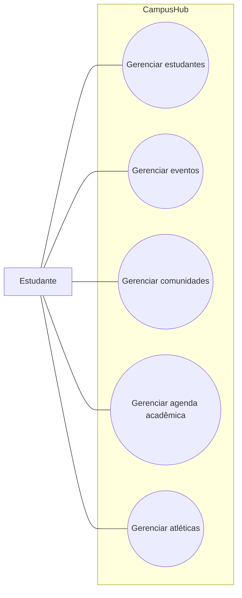

# Diagrama de casos de uso

O ator Estudante representa o público-alvo principal indicado no documento inicial. Cada caso de uso de gerenciamento contempla cadastrar, consultar, editar e excluir.

Este é um diagrama simplificado das funcionalidades. Os quatro comportamentos CRUD podem ser detalhados individualmente em uma versão posterior.
