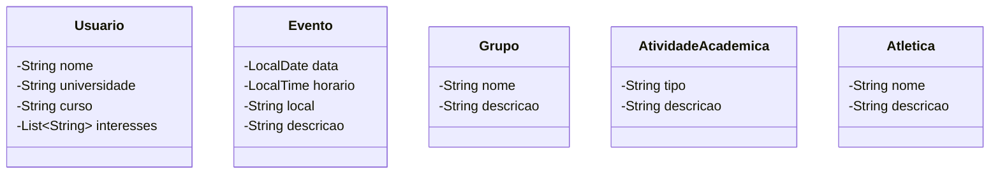

# Diagrama de classes

As cinco entidades abaixo vêm do escopo aprovado. Os atributos explicitamente citados no documento foram preservados. Atributos marcados como sugestões precisam ser validados pela equipe.

**Atenção:** `nome` e `descricao` em `Grupo` e `Atletica`, e `tipo` e `descricao` em `AtividadeAcademica`, são sugestões iniciais, não atributos definidos no documento. `LocalDate` e `LocalTime` são tipos Java sugeridos. O documento não define associações entre as entidades; por isso, elas não foram inventadas no diagrama.
