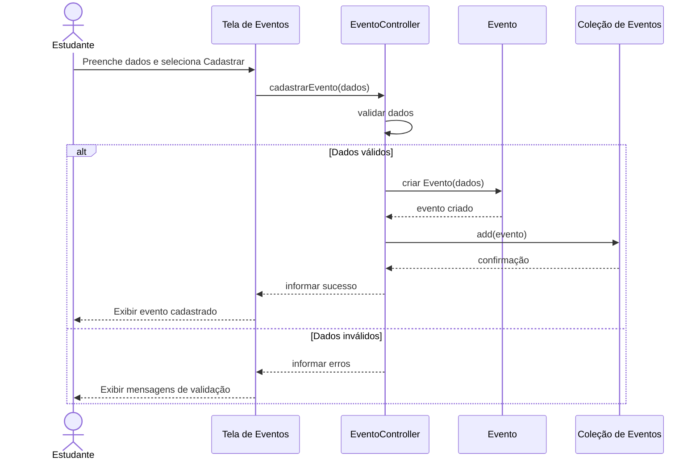

# Diagrama de sequência — cadastro de evento

Exemplo proposto de uma operação CRUD, usando a separação View, Controller e Model e uma coleção em memória.

O uso de uma coleção como `ArrayList<Evento>` é uma proposta coerente com a referência técnica do projeto. O diagrama não representa persistência em banco de dados.
